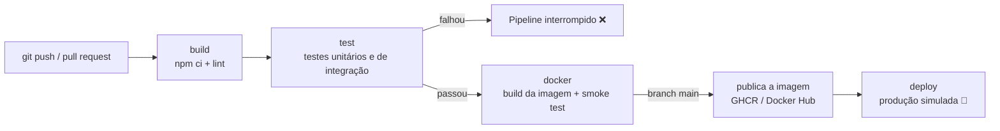

# Loja Virtual UNOPAR — Pipeline de CI/CD

Projeto da aula prática **Infraestrutura Ágil — Simular o monitoramento de processo de pipeline de entrega utilizando o GIT**.

É uma pequena **loja virtual** (Node.js + Express) com catálogo de produtos, carrinho, cupons de desconto e cálculo de frete, acompanhada de um **pipeline de entrega contínua** com os estágios:

**build → test → docker → deploy**

O roteiro da aula é baseado no **GitLab CI/CD** (`.gitlab-ci.yml`), mas o pipeline é executado de fato no **GitHub Actions** (`.github/workflows/ci.yml`). O repositório contém os **dois arquivos equivalentes**.

---

## Tecnologias

| Item | Tecnologia |
|------|------------|
| Back-end | Node.js 20+ e Express |
| Front-end | HTML, JavaScript e Bootstrap 5 (CDN) |
| Testes | `node:test` (executor nativo do Node.js) + `supertest` |
| Lint | ESLint 9 (flat config) |
| Contêiner | Docker (`node:20-alpine`) |
| CI/CD | GitHub Actions (execução real) e GitLab CI/CD (equivalente) |

## Estrutura do projeto

```text
UNOPAR_CI_CD/
├── .github/workflows/ci.yml   # Pipeline do GitHub Actions (executado de verdade)
├── .gitlab-ci.yml             # Pipeline equivalente no GitLab CI/CD
├── Dockerfile                 # Imagem de produção da aplicação
├── public/                    # Vitrine da loja (HTML, JS, CSS)
├── src/
│   ├── app.js                 # Rotas da API (Express)
│   ├── carrinho.js            # Regras de negócio: subtotal, cupom, frete e total
│   ├── produtos.js            # Catálogo de produtos em memória
│   └── server.js              # Inicializa o servidor (porta 3000)
└── test/
    ├── carrinho.test.js       # Testes unitários
    └── api.test.js            # Testes de integração da API
```

## Regras de negócio

- **Cupons:** `UNOPAR10` = 10% de desconto; `BEMVINDO` = R$ 20,00 de desconto fixo. Cupom inexistente gera erro.
- **Frete:** grátis para compras a partir de **R$ 200,00** (após o desconto); abaixo disso, **R$ 19,90**.
- Valores monetários arredondados para 2 casas decimais.

## API

| Método | Rota | Descrição |
|--------|------|-----------|
| GET | `/api/health` | Saúde da aplicação: `{ "status": "ok", "versao": "1.0.0" }` |
| GET | `/api/produtos` | Lista os produtos (filtro opcional `?categoria=acessorios`) |
| GET | `/api/produtos/:id` | Detalhe de um produto (404 se não existir) |
| POST | `/api/carrinho/total` | Calcula `{ subtotal, desconto, frete, total }` |

Exemplo:

```bash
curl -X POST http://localhost:3000/api/carrinho/total \
  -H "Content-Type: application/json" \
  -d '{"itens":[{"id":2,"quantidade":2},{"id":6,"quantidade":1}],"cupom":"BEMVINDO"}'
# {"subtotal":159.7,"desconto":20,"frete":19.9,"total":159.6}
```

## Como executar localmente

Pré-requisito: Node.js 20 ou superior.

```bash
npm install      # instala as dependências
npm run lint     # verifica o padrão do código (ESLint)
npm test         # executa os testes unitários e de integração
npm start        # inicia a loja em http://localhost:3000
```

Para usar outra porta: `PORT=3001 npm start`.

### Com Docker

```bash
docker build -t loja-virtual-unopar .
docker run -d --name loja -p 3000:3000 loja-virtual-unopar
curl http://localhost:3000/api/health
docker rm -f loja
```

## Pipeline de CI/CD



| Estágio | O que faz | Quando roda |
|---------|-----------|-------------|
| **build** | `npm ci`, `npm run lint` e `node --check` nos arquivos de `src/` | Todo push e pull request |
| **test** | `npm test`; publica o resumo (total, aprovados, falhas) e o arquivo `resultado-testes.txt` como artefato | Após o build |
| **docker** | Constrói a imagem, sobe o container e testa `GET /api/health`; na `main`, publica a imagem | Após os testes |
| **deploy** | Deploy **simulado** no ambiente `production` | Somente na `main` |

Se **qualquer teste falhar**, o job `test` falha e os estágios `docker` e `deploy` **não são executados**: nenhuma versão com defeito chega à produção.

### Monitorando o pipeline no GitHub

1. Acesse a aba **Actions** do repositório.
2. Abra a execução **Pipeline CI/CD - Loja Virtual** do commit desejado.
3. Veja o grafo dos jobs (build → test → docker → deploy) e o **Summary**, com o resultado dos testes, as tags da imagem e o resumo do deploy.
4. Baixe o artefato **resultado-testes** para consultar a saída completa dos testes.
5. A imagem publicada aparece em **Packages** (GitHub Container Registry) e o deploy em **Environments → production**.

## Equivalência GitLab CI/CD x GitHub Actions

| Conceito | GitLab CI/CD (`.gitlab-ci.yml`) | GitHub Actions (`.github/workflows/ci.yml`) |
|----------|---------------------------------|---------------------------------------------|
| Arquivo do pipeline | `.gitlab-ci.yml` na raiz | `.github/workflows/ci.yml` |
| Estágios (ordem) | `stages: [build, test, docker, deploy]` | Dependência entre jobs com `needs:` |
| Job | Chave de primeiro nível (ex.: `build:`) com `stage:` | Item em `jobs:` (ex.: `build:`) |
| Comandos | `script:` | `steps:` com `run:` |
| Ambiente de execução | `image: node:20` | `runs-on: ubuntu-latest` + `actions/setup-node` (Node 20) |
| Serviços auxiliares | `services: [docker:24-dind]` | Docker já disponível no runner (`services:` também existe) |
| Condição de execução | `rules: - if: $CI_COMMIT_BRANCH == $CI_DEFAULT_BRANCH` | `if: github.ref == 'refs/heads/main'` |
| Artefatos | `artifacts:` (`paths`, `reports: junit`, `when: always`) | `actions/upload-artifact` com `if: always()` |
| Cache | `cache:` com `paths: node_modules/` | `actions/setup-node` com `cache: npm` |
| Variáveis | `variables:` e Settings → CI/CD → Variables | `env:` e Settings → Secrets and variables |
| Variáveis predefinidas | `$CI_COMMIT_SHORT_SHA`, `$CI_COMMIT_BRANCH` | `${{ github.sha }}`, `${{ github.ref_name }}` |
| Credenciais do registro | `$DOCKERHUB_USER` / `$DOCKERHUB_TOKEN` (Docker Hub) | `secrets.GITHUB_TOKEN` (GHCR) |
| Ambiente de deploy | `environment: name: production` | `environment: name: production` |
| Monitoramento | CI/CD → Pipelines | Aba Actions → execução → Summary |

## Licença

Projeto acadêmico, distribuído sob a licença MIT.
